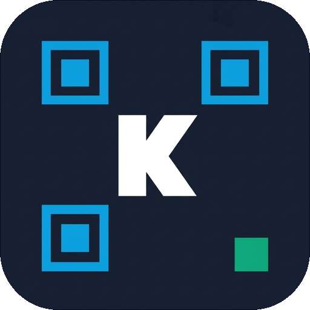
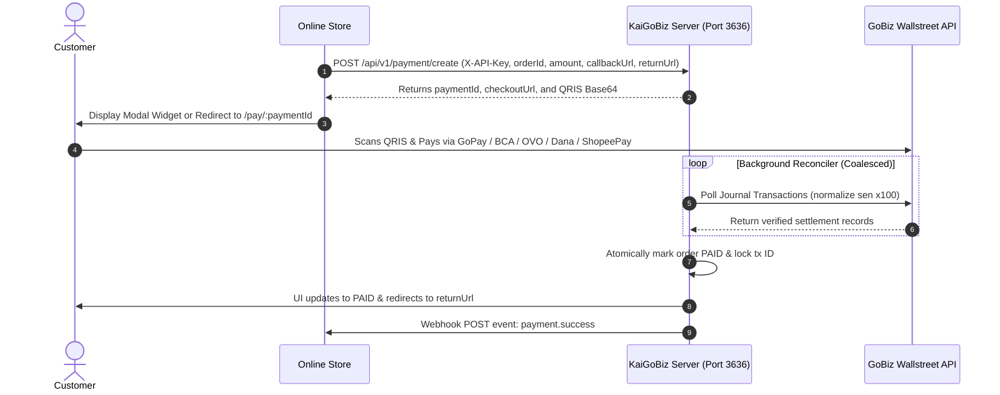

<div align="center">



# KaiGoBiz
### High-Performance GoBiz Payment Gateway, Dynamic QRIS Generator & Mutasi Scraper

[](https://github.com/kaivyy/kaigobiz/releases/tag/v1.2.0)
[](https://www.typescriptlang.org/)
[](https://hono.dev)
[](https://vitest.dev)
[](docs/INTEGRATION_GUIDE.md)
[](LICENSE)

<p align="center">
  Turn any personal or merchant GoBiz account into an automated, zero-fee payment gateway.<br/>
  Generate dynamic QRIS codes, reconcile transactions in real time, and dispatch instant webhooks to your online store.
</p>

[Key Features](#key-features) - [Why KaiGoBiz](#why-kaigobiz) - [Architecture](#architecture--payment-flow) - [Anti-Ban & Session Resilience](#gobiz-anti-ban--session-resilience) - [Quick Start](#quick-start) - [Integration Guide](docs/INTEGRATION_GUIDE.md) - [REST API Reference](#rest-api-reference)

</div>

---

## Key Features

- **High-Performance SQLite Storage (WAL Mode)**: Native `node:sqlite` engine (Node.js 22+ LTS) running with Write-Ahead Logging (`WAL`), `busy_timeout = 5000ms`, `synchronous = NORMAL`, `0o600` file permissions, atomic paid order claiming (`markOrderPaidIfPending`), and partial unique indexes (`CREATE UNIQUE INDEX ... WHERE status = 'PENDING'`) preventing race-condition collisions.
- **Dynamic QRIS Generator**: Generates custom-amount QRIS payments on the fly from any static GoBiz QRIS template using EMVCo Tag 54 UTF-8 TLV encoding and CRC16 CCITT recalculation.
- **Collision-Free Dynamic Unique Code**: Automatic micro-nominal adjustment (`ADD` or `SUBTRACT` mode) ensuring 100% automated settlement matching without amount collision.
- **Anti-Ban Session Persistence**: Bound device fingerprint (`x-uniqueid`), `Set-Cookie` refresh token rotation, real JWT expiry tracking, silent Camoufox `--refresh-only` recovery, persistent SQLite 429/401 circuit breaker, and strict OTP cooldown/hourly/daily limits.
- **Automated Background Reconciliation**: Background reconciler polls GoBiz with anti-bot jitter and single-flight coalescing (`gobiz-sync.ts`), normalizes Wallstreet minor units (sen x100), matches transactions by amount and timestamp, and marks orders `PAID`.
- **Three Flexible Checkout Modes**:
  1. **Hosted Checkout Page** (`/pay/:paymentId`): Pre-built responsive payment page with QR code, live countdown, copy-to-clipboard, and dedicated `returnUrl` post-payment redirect.
  2. **Embeddable Modal Widget** (`kaigobiz.js`): Lightweight modal popup script that works on any website with a single `<script>` tag.
  3. **Headless REST API**: Full JSON API for custom backends (Laravel, Express, Django) and white-label checkouts.
- **Auto-Generated Admin API Key Security**: Generates `KAIGOBIZ_API_KEY` automatically on first boot/install with timing-safe verification middleware, split CORS (`ALLOWED_ORIGINS`), CSP/XFO security headers, and an accessible in-page dashboard API key modal (no toast noise or `window.prompt`).
- **Instant Webhook Engine**: Dispatches HMAC-SHA256 signed HTTP POST notifications when payments settle, defended against SSRF with DNS resolution pinning and `maxRedirects: 0`, with 5x automatic retry even when no pending orders remain.
- **QRIS Studio**: Multi-engine QR extraction featuring client-side `jsQR` HTML5 Canvas (file upload, drag & drop, clipboard paste `Ctrl+V`) and asynchronous server-side Python fallback (`zxingcpp`, `pyzbar`, OpenCV, and `pdftoppm`).

---

## Why KaiGoBiz?

| Capability | KaiGoBiz | Third-Party Gateway (Midtrans/Xendit) | Manual Bank Transfer |
| :--- | :--- | :--- | :--- |
| **Gateway Transaction Fee** | **Rp 0** (Free & Self-Hosted) | Rp 750 to Rp 4.500 + MDR per tx | Rp 0 |
| **Merchant MDR** | Standard 0.3% GoBiz official | 0.7% to 1.5% + Gateway markup | 0% |
| **Settlement Payout** | **Direct to GoBiz (H+0 / H+1)** | Held for days (H+2 to H+7 payout) | Immediate but unverified |
| **Corporate Legal Entity** | **Not Required** (Personal GoBiz OK) | Required (KTP, NPWP, SIUP, NIB) | Not Required |
| **Dynamic Amount QRIS** | **Yes** (Exact amount, zero manual input) | Yes | No (Customer types amount) |
| **Auto Verification** | **Yes** (Real-time mutasi polling) | Yes | No (Manual mutation checking) |
| **Hosted Checkout Page** | **Yes** (`/pay/:paymentId`) | Yes | No |
| **Embeddable Modal** | **Yes** (`kaigobiz.js`) | Yes (Heavy iframe) | No |
| **Instant Webhooks** | **Yes** (HTTP POST + HMAC-SHA256) | Yes | No |

---

## Architecture & Payment Flow



---

## GoBiz Anti-Ban & Session Resilience

To keep merchant sessions alive long-term and prevent phone number bans caused by repeated SMS OTP logins:

- **Pinned Fingerprint & Protocol Alignment**: Each session generates and persists a single `device_id` (`x-uniqueid`) and deterministic browser User-Agent/device profile instead of switching OS/UA across refreshes.
- **Set-Cookie Rotation & Full Cookie Jar**: Extracts rotated `refresh_token` / `access_token` values from both JSON responses and `Set-Cookie` headers while preserving Cloudflare and GoBiz cookies (`cf_clearance`, `__cf_bm`, `browser_id`).
- **Real JWT Expiry & Adaptive Refresh Buffer**: Parses `exp` and `iat` claims from JWT access tokens (falling back to `expires_in`) and triggers proactive refresh at 20% remaining lifetime (clamped between 2 minutes and 60 minutes).
- **Silent Zero-OTP Browser Recovery**: When direct HTTP refresh encounters anti-bot `401`/`403` rejections, `SessionManager` invokes `camoufox_gobiz_worker.py --refresh-only` against `.camoufox-profile` to renew tokens quietly without sending any SMS OTP. Interactive login also detects `already_authenticated` browser sessions automatically.
- **Persisted Circuit Breaker & OTP Quotas**: `authGuardState` (`permanentlyInvalid`, exponential `backoffUntil`, `rateLimitedUntil` honoring `Retry-After`) and per-phone OTP history (`otpRequestHistory`: 60s cooldown, max 3/hour, max 5/24h) are stored in SQLite `app_config` so PM2 restarts never replay dead-token requests. Requesting OTP for a phone with a still-valid session returns `409 SESSION_ALREADY_ACTIVE` unless `force: true` is sent.
- **Shared Transaction Sync Throttling**: Reconciler, `/payment/status/:id`, and `/transactions` share a single-flight coordinator (`src/core/gobiz-sync.ts`) with cooldown jitter, early pagination cutoff (`stopBeforeTimestamp`), and automatic bypass during active rate-limit windows.

---

## Quick Start

### Option A: 1-Click Automated Installer (Recommended for Linux VPS)

The installer script installs OS packages, Python QR decoders + Camoufox, Node.js 22 LTS, npm dependencies, auto-generates `KAIGOBIZ_API_KEY` into `.env`, builds production bundles, and starts PM2:

```bash
# Direct run from cloned folder
./install.sh

# Or one-line automated install directly from GitHub
curl -fsSL https://raw.githubusercontent.com/kaivyy/kaigobiz/main/install.sh | bash
```

---

### Option B: Manual Installation

#### 1. Clone & Install Dependencies

```bash
git clone https://github.com/kaivyy/kaigobiz.git
cd kaigobiz
npm install
```

#### 2. Configure Environment (`.env`)

Create a `.env` file (or let the server auto-generate `KAIGOBIZ_API_KEY` into `.env` on first start):

```env
PORT=3636
NODE_ENV=production
# Auto-generated by server/install.sh if omitted:
# KAIGOBIZ_API_KEY=kgb_...
# Set true only if running on a private localhost/VPN without API key auth:
# KAIGOBIZ_DISABLE_AUTH=true
# Optional global fallback webhook URL & HMAC secret:
WEBHOOK_URL=https://your-domain.com/api/payment-webhook
WEBHOOK_SECRET=your-hmac-secret
# Optional default QRIS template (can also be saved via Dashboard)
STATIC_QRIS_TEMPLATE=00020101021126390013ID.GO-JEK.WWW01189360091430000000005204581253033605802ID5914KAI GOBIZ SHOP6007JAKARTA63045B63
```

#### 3. Build & Run

```bash
# Build TypeScript, Vite dashboard, and kaigobiz.js widget
npm run build

# Start the server directly
npm run server

# Or run in background 24/7 with PM2
pm2 start "npm run server" --name kaigobiz
pm2 save
```

Access the Admin Dashboard at: `http://localhost:3636`. If `KAIGOBIZ_API_KEY` is active and `KAIGOBIZ_DISABLE_AUTH` is not `true`, enter the key from `.env` via the in-page API Key modal (accessible anytime via the **API Key** button in the top-right header).

---

## Environment Variables

| Variable | Description | Default |
| :--- | :--- | :--- |
| `PORT` | Listening HTTP port for API, Dashboard, and Checkout | `3636` |
| `NODE_ENV` | Runtime environment (`production`, `development`, or `test`) | `production` |
| `KAIGOBIZ_API_KEY` | Admin/API key (`X-API-Key` or `Authorization: Bearer`); auto-generated into `.env` if absent | Auto-generated (`kgb_...`) |
| `KAIGOBIZ_DISABLE_AUTH` | Set `true` to disable `KAIGOBIZ_API_KEY` enforcement on trusted local/VPN networks | `false` |
| `KAIGOBIZ_PUBLIC_CREATE` | Set `true` to allow `POST /api/v1/payment/create` without an API key for browser widgets | `false` |
| `ALLOWED_ORIGINS` | Comma-separated allowlist for strict CORS on admin & checkout endpoints | Empty (restrictive for admin) |
| `WEBHOOK_URL` | Global fallback webhook URL for payment notifications | `null` |
| `WEBHOOK_SECRET` | Secret key for generating `X-KaiGoBiz-Signature` HMAC-SHA256 headers | `null` |
| `ALLOW_LOCAL_WEBHOOKS` | Set `true` only in isolated testing if webhooks target localhost/private IPs | `false` |
| `STATIC_QRIS_TEMPLATE` | Fallback EMVCo static QRIS string for dynamic injection | Built-in template |
| `GOBIZ_APP_VERSION` | Override `x-appversion` header sent to GoBiz APIs | `platform-v3.131.0-93e290ae` |
| `KAIGOBIZ_LOGIN_MODE` | Set `browser` to skip direct HTTP OTP and launch Camoufox directly | Direct then fallback |
| `KAIGOBIZ_DISABLE_BROWSER_REFRESH` | Set `true` to disable silent `--refresh-only` Camoufox fallback | `false` |

---

## Integration Modes

KaiGoBiz supports three distinct integration approaches depending on your application needs:

### Mode 1: Hosted Checkout Page (Recommended)

Redirect customers to a pre-built, responsive checkout page (`http://IP:3636/pay/:paymentId`).

#### 1. Create Payment Order from Backend

```bash
curl -X POST http://localhost:3636/api/v1/payment/create \
  -H "Content-Type: application/json" \
  -H "X-API-Key: kgb_your_api_key_from_env" \
  -d '{
    "orderId": "INV-2026-002",
    "amount": 50000,
    "expiryMinutes": 5,
    "callbackUrl": "https://yourshop.com/webhook",
    "returnUrl": "https://yourshop.com/order/thank-you",
    "useUniqueCode": true,
    "uniqueCodeMin": 1,
    "uniqueCodeMax": 250,
    "uniqueCodeType": "ADD"
  }'
```

**Response (HTTP 200):**
```json
{
  "success": true,
  "paymentId": "pay_a1b2c3d4e5f6001122334455",
  "orderId": "INV-2026-002",
  "amount": 50124,
  "rawAmount": 50000,
  "uniqueCode": 124,
  "qrisString": "00020101021226610014COM.GO-JEK.WWW...540550124...6304A1B2",
  "qrisQrUrl": "data:image/png;base64,iVBORw0KGgoAAAANSUhEUg...",
  "checkoutUrl": "http://localhost:3636/pay/pay_a1b2c3d4e5f6001122334455",
  "expiresAt": "2026-11-28T04:00:00.000Z",
  "callbackUrl": "https://yourshop.com/webhook",
  "returnUrl": "https://yourshop.com/order/thank-you"
}
```

#### 2. Redirect Customer

Redirect your customer's browser to `checkoutUrl`. The page manages QR display, real-time status polling, countdown timer, copy-to-clipboard, and redirects to `returnUrl` upon `PAID` settlement.

---

### Mode 2: Embeddable Modal Widget (`kaigobiz.js`)

Keep customers on your website with an in-page modal dialog (if called directly from frontend browser, set `KAIGOBIZ_PUBLIC_CREATE=true` or proxy `/create` via your backend):

```html
<!-- Load KaiGoBiz Widget -->
<script src="http://localhost:3636/kaigobiz.js"></script>

<button id="pay-btn" type="button">Bayar Sekarang</button>

<script>
  document.getElementById('pay-btn').addEventListener('click', () => {
    KaiGoBiz.checkout({
      endpoint: "http://localhost:3636",
      orderId: "INV-2026-003",
      amount: 50000,
      expiryMinutes: 10,
      callbackUrl: "https://yourshop.com/webhook",
      useUniqueCode: true,
      uniqueCodeMax: 250,
      uniqueCodeType: "ADD",
      onSuccess: (payment) => {
        window.location.href = "/order/thank-you";
      },
      onPending: (payment) => {
        console.log("Menunggu pembayaran...", payment);
      },
      onExpired: () => {
        alert("Waktu pembayaran telah habis. Silakan buat pesanan baru.");
      },
      onError: (err) => {
        console.error("Gagal memulai pembayaran:", err);
      }
    });
  });
</script>
```

---

### Mode 3: Headless API & Custom UI (100% White-Label)

Build your own checkout interface without KaiGoBiz branding.

#### Step 1: Create Payment on Backend

##### PHP / Laravel
```php
<?php

$payload = [
    'orderId'        => 'INV-' . time(),
    'amount'         => 75000,
    'expiryMinutes'  => 15,
    'callbackUrl'    => 'https://tokoanda.com/api/payment-callback',
    'returnUrl'      => 'https://tokoanda.com/order/thanks',
    'useUniqueCode'  => true,
    'uniqueCodeMax'  => 250,
    'uniqueCodeType' => 'ADD'
];

$ch = curl_init('http://localhost:3636/api/v1/payment/create');
curl_setopt($ch, CURLOPT_RETURNTRANSFER, true);
curl_setopt($ch, CURLOPT_POST, true);
curl_setopt($ch, CURLOPT_HTTPHEADER, [
    'Content-Type: application/json',
    'X-API-Key: ' . getenv('KAIGOBIZ_API_KEY')
]);
curl_setopt($ch, CURLOPT_POSTFIELDS, json_encode($payload));

$response = curl_exec($ch);
curl_close($ch);

$data = json_decode($response, true);
```

##### Node.js / Express
```javascript
import axios from 'axios';

app.post('/api/checkout', async (req, res) => {
  try {
    const response = await axios.post(
      'http://localhost:3636/api/v1/payment/create',
      {
        orderId: `ORDER-${Date.now()}`,
        amount: req.body.totalAmount,
        expiryMinutes: 10,
        callbackUrl: 'https://myshop.com/api/webhook',
        returnUrl: 'https://myshop.com/order/thanks',
        useUniqueCode: true,
        uniqueCodeMax: 250,
        uniqueCodeType: 'ADD'
      },
      {
        headers: { 'X-API-Key': process.env.KAIGOBIZ_API_KEY }
      }
    );

    res.json({
      paymentId: response.data.paymentId,
      orderId: response.data.orderId,
      amount: response.data.amount,
      rawAmount: response.data.rawAmount,
      uniqueCode: response.data.uniqueCode,
      qrisQrUrl: response.data.qrisQrUrl,
      expiresAt: response.data.expiresAt
    });
  } catch (error) {
    const errMessage = error.response?.data?.error || 'Gagal membuat pembayaran';
    res.status(400).json({ error: errMessage });
  }
});
```

#### Step 2: Render Custom UI & Poll Status on Frontend

```html
<div class="custom-checkout-card">
  <h3>Pembayaran QRIS</h3>
  <div id="order-label">Order: #INV-10023</div>
  <div class="price" id="pay-amount">Rp 50.124</div>

  <!-- Render Base64 QRIS Image -->
  

  <p>Pindai menggunakan aplikasi GoPay, BCA, OVO, Dana, ShopeePay, atau mobile banking apa saja.</p>
  <div id="payment-status">Menunggu pembayaran...</div>
</div>

<script>
  const paymentId = "PAYMENT_ID_FROM_BACKEND";
  const qrisQrUrl = "QRIS_QR_URL_FROM_BACKEND";

  document.getElementById('qris-img').src = qrisQrUrl;

  const pollTimer = setInterval(async () => {
    try {
      const res = await fetch(`http://localhost:3636/api/v1/payment/status/${paymentId}`);
      const data = await res.json();

      if (data.status === 'PAID') {
        clearInterval(pollTimer);
        document.getElementById('payment-status').textContent = 'Pembayaran Berhasil!';
        setTimeout(() => {
          window.location.href = '/checkout/success?order=' + encodeURIComponent(data.orderId);
        }, 1200);
      } else if (data.status === 'EXPIRED') {
        clearInterval(pollTimer);
        document.getElementById('payment-status').textContent = 'Waktu pembayaran telah habis.';
      }
    } catch (err) {
      console.error('Polling error:', err);
    }
  }, 3000);
</script>
```

---

## Webhook Notifications

When a payment is matched by the background reconciler, KaiGoBiz dispatches an HTTP POST webhook notification to your configured URL.

### Security Headers

| Header | Description | Example |
| :--- | :--- | :--- |
| `Content-Type` | MIME payload type | `application/json` |
| `User-Agent` | Webhook client identity | `KaiGoBiz-Webhook/1.0` |
| `X-KaiGoBiz-Timestamp` | ISO 8601 creation timestamp | `2026-11-28T03:00:00.000Z` |
| `X-KaiGoBiz-Signature` | HMAC-SHA256 signature (if configured) | `sha256=a1b2c3d4e5f6...` |

> [!NOTE]
> SSRF Protection: KaiGoBiz validates webhook and `returnUrl` destinations, rejecting private/CGNAT/IPv4-mapped IPv6/loopback hosts, resolving DNS with private-IP checks, pinning resolved IPs on the HTTP agent to prevent DNS rebinding TOCTOU, and disabling redirects (`maxRedirects: 0`).

### Webhook Delivery & Retries

- **Timeout**: Each HTTP dispatch times out after 10 seconds.
- **Automatic Retries**: Non-2xx responses or connection failures are retried automatically up to **5 times** (every 30+ seconds) even when no active pending orders remain.

### Webhook Payload Schema

```json
{
  "event": "payment.success",
  "paymentId": "pay_a1b2c3d4e5f6001122334455",
  "orderId": "INV-2026-002",
  "amount": 50124,
  "status": "PAID",
  "paidAt": "2026-11-28T03:02:15.000Z",
  "transactionId": "f4b8a1c2-3d4e-5f6a-7b8c-9d0e1f2a3b4c",
  "timestamp": "2026-11-28T03:02:15.000Z"
}
```

### Webhook Verification Examples

#### Node.js / Express
```javascript
import express from 'express';
import crypto from 'crypto';

const app = express();
const WEBHOOK_SECRET = process.env.WEBHOOK_SECRET || 'your-webhook-secret';

app.post('/api/webhook', express.json({
  verify: (req, _res, buf) => {
    req.rawBody = buf.toString();
  }
}), (req, res) => {
  const signatureHeader = req.headers['x-kaigobiz-signature'];

  if (WEBHOOK_SECRET && signatureHeader) {
    const expectedSignature = 'sha256=' + crypto
      .createHmac('sha256', WEBHOOK_SECRET)
      .update(req.rawBody)
      .digest('hex');

    const expectedBuffer = Buffer.from(expectedSignature);
    const signatureBuffer = Buffer.from(String(signatureHeader));

    if (
      expectedBuffer.length !== signatureBuffer.length ||
      !crypto.timingSafeEqual(expectedBuffer, signatureBuffer)
    ) {
      return res.status(401).json({ error: 'Invalid webhook signature' });
    }
  }

  const { event, orderId, amount, transactionId, status } = req.body;

  if (event === 'payment.success' && status === 'PAID') {
    console.log(`Order ${orderId} lunas sebesar Rp ${amount}. Ref GoBiz: ${transactionId}`);
  }

  return res.status(200).json({ received: true });
});
```

#### PHP / Laravel
```php
<?php

$rawBody = file_get_contents('php://input');
$signatureHeader = $_SERVER['HTTP_X_KAIGOBIZ_SIGNATURE'] ?? null;
$webhookSecret = getenv('WEBHOOK_SECRET') ?: 'your-webhook-secret';

if ($webhookSecret && $signatureHeader) {
    $expectedSignature = 'sha256=' . hash_hmac('sha256', $rawBody, $webhookSecret);
    if (!hash_equals($expectedSignature, $signatureHeader)) {
        http_response_code(401);
        echo json_encode(['error' => 'Invalid webhook signature']);
        exit;
    }
}

$payload = json_decode($rawBody, true);

if (($payload['event'] ?? '') === 'payment.success' && ($payload['status'] ?? '') === 'PAID') {
    $orderId = $payload['orderId'];
    $amount = $payload['amount'];
    $txId = $payload['transactionId'] ?? null;
}

http_response_code(200);
echo json_encode(['received' => true]);
```

---

## REST API Reference

### Overview of Endpoints

| Method | Endpoint | Auth | Description |
| :--- | :--- | :--- | :--- |
| `POST` | `/api/v1/payment/create` | API Key (optional public toggle) | Create dynamic QRIS payment with optional unique code and `returnUrl` |
| `GET` | `/api/v1/payment/status/:paymentId` | Public | Check status with coalesced live reconciliation |
| `GET` | `/api/v1/payment/template` | API Key | Inspect current static QRIS template and merchant metadata |
| `POST` | `/api/v1/payment/template` | API Key | Save or update active static QRIS template (persisted in SQLite) |
| `POST` | `/api/v1/payment/decode-qr` | API Key | Server-side QR extraction from Base64 image/PDF (max 3 concurrent) |
| `GET` | `/api/v1/payment/webhook-config` | API Key | Retrieve global webhook URL |
| `POST` | `/api/v1/payment/webhook-config` | API Key | Update global webhook URL |
| `GET` | `/api/v1/auth/status` | API Key | Check GoBiz connection status, sanitized profile, and `health` telemetry |
| `POST` | `/api/v1/auth/refresh` | API Key | Renew session token via GoBiz refresh or silent browser recovery (zero OTP) |
| `POST` | `/api/v1/auth/refresh-profile` | API Key | Re-fetch merchant profile details from GoBiz |
| `POST` | `/api/v1/auth/request-otp` | API Key | Request GoBiz OTP (guarded by 60s cooldown, 3/hour, 5/day, and 409 active-session check) |
| `POST` | `/api/v1/auth/verify-otp` | API Key | Verify OTP (5 failures/min limit) and save session tokens |
| `POST` | `/api/v1/auth/logout` | API Key | Disconnect and clear GoBiz session |
| `GET` | `/api/v1/transactions` | API Key | Fetch live GoBiz transactions (sen-normalized, shared sync throttling) |
| `GET` | `/api/v1/health` | Public | Server health check and timestamp |
| `GET` | `/pay/:paymentId` | Public | Customer-facing hosted checkout page |

---

### `POST /api/v1/payment/create`

Generate dynamic QRIS for a new payment order.

#### Request Parameters (JSON Body)

| Parameter | Type | Required | Default | Description |
| :--- | :--- | :--- | :--- | :--- |
| `orderId` | `string` | **Yes** | - | Unique merchant order reference (1 to 100 characters) |
| `amount` | `number` | **Yes** | - | Payable base amount in Rupiah (integer between 1 and 100,000,000) |
| `expiryMinutes` | `number` | No | `5` | Order expiration time in minutes (1 to 1440) |
| `callbackUrl` | `string` | No | `null` | Order-specific HTTP/HTTPS webhook URL (SSRF validated) |
| `returnUrl` | `string` | No | `null` | Browser redirect URL after payment completion (SSRF validated) |
| `useUniqueCode` | `boolean` | No | `false` | Enable automatic unique code allocation for collision avoidance |
| `uniqueCodeMin` | `number` | No | `1` | Lower boundary for random unique code (minimum: 1) |
| `uniqueCodeMax` | `number` | No | `250` | Upper boundary for random unique code (maximum: 9999) |
| `uniqueCodeType` | `string` | No | `'ADD'` | Allocation strategy: `'ADD'` or `'SUBTRACT'` |

#### Response Schema (HTTP 200)

```json
{
  "success": true,
  "paymentId": "pay_a1b2c3d4e5f6001122334455",
  "orderId": "INV-2026-002",
  "amount": 50124,
  "rawAmount": 50000,
  "uniqueCode": 124,
  "qrisString": "00020101021226610014COM.GO-JEK.WWW...540550124...6304A1B2",
  "qrisQrUrl": "data:image/png;base64,iVBORw0KGgoAAAANSUhEUg...",
  "checkoutUrl": "http://localhost:3636/pay/pay_a1b2c3d4e5f6001122334455",
  "expiresAt": "2026-11-28T04:00:00.000Z",
  "callbackUrl": "https://yourshop.com/webhook",
  "returnUrl": "https://yourshop.com/order/thank-you",
  "reused": false
}
```

---

### `GET /api/v1/payment/status/:paymentId`

Retrieve current status of a payment order.

#### URL Parameters
- `paymentId` (`string`, required): Unique payment identifier returned by the creation endpoint.

#### Response Schema (HTTP 200)

```json
{
  "success": true,
  "paymentId": "pay_a1b2c3d4e5f6001122334455",
  "orderId": "INV-2026-002",
  "amount": 50124,
  "rawAmount": 50000,
  "uniqueCode": 124,
  "status": "PAID",
  "expiresAt": "2026-11-28T04:00:00.000Z",
  "createdAt": "2026-11-28T03:55:00.000Z",
  "paidAt": "2026-11-28T03:56:15.000Z",
  "transactionId": "f4b8a1c2-3d4e-5f6a-7b8c-9d0e1f2a3b4c",
  "qrisString": "00020101021226610014COM.GO-JEK.WWW...540550124...6304A1B2",
  "qrisQrUrl": "data:image/png;base64,iVBORw0KGgoAAAANSUhEUg..."
}
```

---

## GoBiz Sen Currency Normalization

Gojek Wallstreet Journal API reports transaction gross amounts in minor currency units (*sen* / cents, factor of 100):
- A payment of **Rp 1.000** is reported as `100000` in the GoBiz API.
- The 0.3% MDR fee is reported as `300` (Rp 3).

KaiGoBiz handles this normalization automatically in `GoBizClient` and `Reconciler`. Both raw minor units and normalized Rupiah values are matched with clock-skew tolerance while guarding normalized transactions against 100x smaller false-positive matches.

---

## Testing

Run the Vitest unit and integration test suite:

```bash
npm test
```

All core components (EMVCo parser, UTF-8 TLV byte sizing, dynamic amount injection, CRC16 CCITT validation, SQLite WAL storage and atomic indexes, JWT/cookie refresh, anti-ban rate-limit/OTP guards, auto API key initialization, server routes, and webhooks) are covered by 63 automated tests across 5 suites.

---

## Production PM2 Operations

Keep KaiGoBiz running 24/7 on your Linux VPS using PM2:

```bash
# Start process
pm2 start "npm run server" --name kaigobiz

# Save process list across system reboots
pm2 save
pm2 startup

# Monitor live logs
pm2 logs kaigobiz

# Restart service cleanly with updated env
pm2 restart kaigobiz --update-env

# Check status
pm2 status
```

---

## Security & Privacy

- All GoBiz session tokens, local databases (`.kaigobiz.db*`), configuration files (`.env`, `.kaigobiz-*.json`), browser profiles (`.camoufox-profile/`), and debug screenshots are strictly excluded from version control via `.gitignore`.
- Admin and transaction endpoints are protected by auto-generated `KAIGOBIZ_API_KEY` verification (unless explicitly opted out with `KAIGOBIZ_DISABLE_AUTH=true`), timing-safe token comparisons, SSRF DNS pinning, XSS output escaping, CSP/XFO headers, and `0o600` file permissions.
- No intermediary proxy or third-party cloud servers have access to your credentials or transaction logs.

---

## License

MIT License (c) 2026 KaiGoBiz Team
